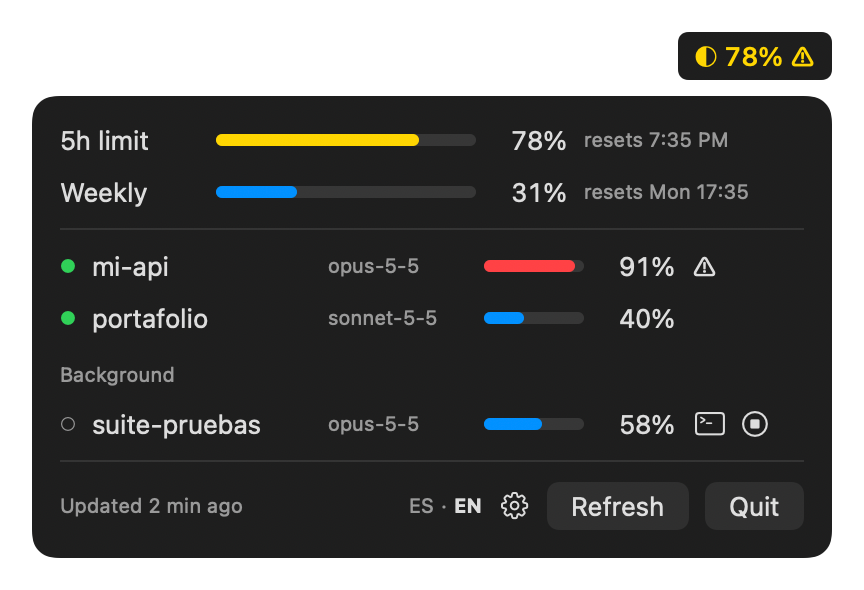

# Claude Usage Bar

A tiny native macOS menu bar app that shows, at a glance:

- your **Claude 5-hour and weekly usage limits** (with reset times),
- every **open Claude Code session** and how much of its **context window** it has used,
- a **notification** when a session is about to fill its context, so you can start a fresh chat before it compacts.

Built for people who juggle several Claude Code sessions across terminals and lose track of their limits.

<p align="center"></p>

> Spanish by default, with English available from the **ES · EN** switch in the panel. Screenshot uses demo data.

## Features

- **Menu bar indicator** — `◐ 42%` = 5-hour limit used; turns yellow at 70% and red at 90%. A `⚠` appears when any session crosses the first context threshold.
- **Limits** — 5-hour and weekly utilization with reset times, refreshed every 5 minutes (plus a manual *Actualizar* button).
- **Sessions** — live Claude Code sessions (read every 5 s), sorted by context usage; background sessions are grouped separately and never alert. Hover a row for exact tokens (`733k / 1M`).
- **Background session controls** — reopen a background session in a new Terminal window (`claude attach <id>`) or stop it (`claude stop <id>`, click twice to confirm; the conversation is kept).
- **Notifications** — at 80% and 90% context per session, and at 90% of the 5-hour limit. Each fires once per crossing and re-arms after usage drops (e.g. after `/compact`). Nothing fires for values already high when the app starts.
- **Activity notifications** — "✓ *session* terminó" when a session goes back to idle after working for 30 s or more, and "⏸ *session* necesita tu respuesta" when it has been waiting for your permission or answer for 15 s. Works for background sessions too, and doesn't depend on your terminal's notification support.
- **Spanish / English** — switch from the panel (**ES · EN**) or with `"language"` in `config.json`; applies to the panel, notifications and time formats.
- **Settings button** (⚙) opens `config.json`; edits apply automatically, no restart needed.
- **Launches at login**, no Dock icon.

## How it works

Everything is read locally and **read-only**:

| Data | Source |
|------|--------|
| Open sessions | `~/.claude/sessions/<pid>.json`, kept only if the process is alive |
| Activity (working / idle / waiting) | the `status` field of that same file (`busy`, `idle`, `waiting`, `blocked`) |
| Context per session | last assistant message's `usage` in `~/.claude/projects/<dir>/<session>.jsonl` (`input + cache_read + cache_creation` tokens) |
| Limits | `GET https://api.anthropic.com/api/oauth/usage` with the OAuth token Claude Code already stores in your Keychain |

The token is read from the Keychain at request time and is never written to disk or logged. The app never refreshes or modifies credentials; if the token has expired, open Claude Code and it will renew it.

> ⚠️ The usage endpoint is **not a public, documented API**. It is what Claude Code uses internally and may change or break at any time.

## Requirements

- macOS 14+
- Swift 6 toolchain — the Xcode **Command Line Tools** are enough (`xcode-select --install`); full Xcode is not required
- Claude Code installed and logged in

## Build & install

```bash
./build.sh            # builds dist/ClaudeUsageBar.app (ad-hoc signed)
./build.sh --install  # also copies it to ~/Applications
open ~/Applications/ClaudeUsageBar.app
```

Allow notifications when prompted. The app registers itself as a login item (System Settings → General → Login Items).

Other commands:

```bash
./test.sh                                      # run the test suite (Swift Testing)
swift run ClaudeUsageBar --demo                # run with fictional data
swift run ClaudeUsageBar --render-demo out.png [--lang en]  # render the panel with demo data to a PNG
```

`test.sh` wraps `swift test` with the framework paths Swift Testing needs when only the Command Line Tools are installed.

## Configuration

On first launch the app writes `~/Library/Application Support/ClaudeUsageBar/config.json` with the defaults. Open it from the ⚙ button in the panel; changes are picked up within a few seconds (new settings from later versions are added to the file automatically, keeping your values):

```json
{
  "barWarn": 70,
  "barCritical": 90,
  "contextThresholds": [80, 90],
  "limitThreshold": 90,
  "sessionPollSeconds": 5,
  "limitsPollSeconds": 300,
  "defaultContextWindow": 1000000,
  "modelContextWindows": { "claude-haiku": 200000 },
  "notifyActivity": true,
  "notifyFinishedAfterSeconds": 30,
  "notifyWaitingAfterSeconds": 15,
  "language": "es"
}
```

Transcripts don't say which context window a session uses, so every model is assumed to have `defaultContextWindow` tokens unless a model-id prefix in `modelContextWindows` says otherwise (longest prefix wins).

## Project layout

```
Sources/UsageCore/       pure logic, fully tested: config, session registry,
                         transcript reader, limits client, snapshot, alert rules
Sources/ClaudeUsageBar/  SwiftUI MenuBarExtra app, timers, notifications
Tests/UsageCoreTests/    tests with synthetic fixtures only
```

## Limitations

- Only Claude Code sessions started from a terminal (including VS Code's integrated terminal). The Claude desktop app and claude.ai browser chats are not tracked.
- Context size is an estimate based on the last API response; it updates after each assistant reply.
- Activity states come from an undocumented field in Claude Code's session files and may change between versions.

## Disclaimer

Independent personal project. Not affiliated with, endorsed by, or supported by Anthropic. "Claude" is a trademark of Anthropic.

## License

[MIT](LICENSE)
